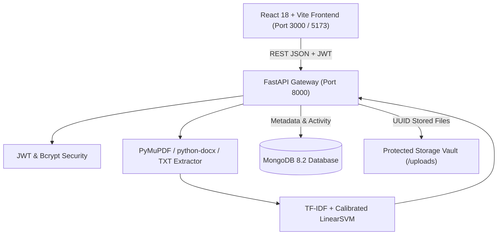

# Smart Document Classification and Management System Using NLP

> **B.Tech IV Year DevOps & Full Stack Course Project — Academic Year 2026–2027**  
> Total Evaluation: **10 Marks** (Code Quality: 2 | Git & Repo: 2 | Docker: 2 | Kubernetes: 2 | Documentation: 2)

---

## 1. Project Title
**Smart Document Classification and Management System Using NLP**

---

## 2. Project Overview
Smart Document Classification and Management System is a full-stack, enterprise-grade web application that automates the ingestion, textual analysis, categorization, search, and lifecycle management of digital documents. Rather than relying solely on arbitrary filenames, the system extracts textual content from uploaded PDF, DOCX, and TXT files, preprocesses the vocabulary, and classifies each document into domain-specific categories using a calibrated Linear Support Vector Machine (LinearSVM) trained on TF-IDF features.

The application features a modern SaaS dashboard inspired by Linear and Notion, complete with JWT-authenticated per-user vaults, live MongoDB storage, interactive Recharts analytics, full-text search, in-browser document previewing, and human-in-the-loop category correction.

---

## 3. Problem Statement
In modern enterprises and academic institutions, digital documents (resumes, vendor invoices, legal agreements, research manuscripts, syllabus outlines) are frequently stored in disorganized shared drives with non-descriptive names (e.g. `Scan_001.pdf` or `Document (1).docx`). Manual tagging and folder sorting are labor-intensive, error-prone, and lack standardized metadata. Furthermore, conventional search systems cannot search within unindexed file bodies, hindering fast document retrieval.

---

## 4. Objectives
- **Automated Text Extraction**: Parse readable text from digital PDF, DOCX, and TXT formats without requiring proprietary cloud APIs.
- **Genuine Machine Learning Classification**: Classify documents into 7 core enterprise domains using scikit-learn without hardcoded rules.
- **Calibrated Confidence Scoring**: Output mathematically calibrated probabilities using Platt sigmoid scaling, with a conservative fallback policy for ambiguous documents.
- **Secure Tenancy & Storage**: Provide isolated document storage and metadata querying per authenticated user.
- **Human-in-the-Loop Feedback**: Enable users to review predictions, inspect extracted text, and record manual category corrections.
- **DevOps Readiness**: Containerize using multi-stage Dockerfiles and deploy using declarative Kubernetes manifests.

---

## 5. Existing System Limitations
- **Filename-Only Heuristics**: Conventional operating system search relies on user-supplied filenames, failing when files have generic names.
- **Proprietary Cloud Lock-In**: Many modern systems depend on paid cloud LLM APIs (OpenAI, AWS Comprehend), introducing high per-document costs, latency, and privacy compliance concerns.
- **Binary Metadata Blindness**: Traditional file servers treat documents as opaque binary blobs without indexing structural paragraphs or line items.
- **Uncalibrated Heuristics**: Simple keyword matchers lack probability estimates and cannot flag borderline documents for human review.

---

## 6. Proposed System
Our system implements a self-hosted, lightweight, and deterministic text classification architecture:
- Text is extracted via **PyMuPDF** and **python-docx**.
- Raw strings are cleaned using **Unicode NFKD normalization** and regex tokenization.
- Features are vectorized with **TF-IDF unigrams & bigrams**.
- Predictions are generated via **LinearSVC wrapped in CalibratedClassifierCV**.
- Records, word counts, and previews are stored in **MongoDB**, while files are isolated under UUID names.

---

## 7. Main Features
1. **Multi-Format Ingestion**: Drag-and-drop support for PDF, DOCX, and TXT with multi-file batch upload.
2. **Deterministic NLP Inference**: Fast, local inference with zero external API dependencies.
3. **Calibrated Confidence Meter**: Transparent percentage probability display.
4. **Conservative Review Policy**: Automatically flags documents with confidence &lt; 40% or narrow margins as "Needs Review".
5. **Full-Text & Filename Search**: Instant querying across both file names and internal extracted text.
6. **In-Browser Document Preview**: Dedicated inline modal and external viewer for reading parsed text.
7. **Human-in-the-Loop Category Correction**: Allows manual corrections while preserving the original prediction history.
8. **Re-Classification on Demand**: Allows re-running the classification model if updated weights are trained.
9. **Interactive Analytics**: Real-time charts powered by Recharts (Category distribution, daily ingestion velocity).
10. **Secure Single-Tenant Vaults**: JWT bearer tokens, bcrypt password hashing, and user-level MongoDB querying.

---

## 8. Architecture Diagram



---

## 9. Application Workflow
1. **User Sign Up & Login**: Secure registration creates an account with bcrypt salt rounds; JWT token stored in browser session.
2. **File Selection**: User drops a document into the upload zone; client enforces 15MB limit and format checks.
3. **Extraction & Hashing**: Backend computes SHA-256 hash, writes file to `/uploads/<uuid>.<ext>`, and extracts text.
4. **NLP Vectorization & Prediction**: Text is preprocessed, vectorized into TF-IDF features, and passed to Calibrated LinearSVC.
5. **Database Indexing**: Document record, category, confidence score, and text preview are written to MongoDB.
6. **Review & Management**: User searches documents in the library, previews extracted text, downloads files, or applies category corrections.

---

## 10. NLP Pipeline Explanation
- **Extraction**: Parses character runs from PDF pages using PyMuPDF and paragraphs/tables using python-docx. Detects scanned/empty documents.
- **Preprocessing**: Applies Unicode NFKD normalization, lowercasing, email/URL tokenization, special character cleaning, and whitespace collapsing.
- **Vectorization**: Fits a sublinear TF-IDF vectorizer over unigrams and bigrams (`ngram_range=(1, 2)`) with up to 30,000 features.
- **Classification**: Trains Linear Support Vector Classification (`LinearSVC(class_weight='balanced')`).
- **Probability Calibration**: Wraps the classifier in `CalibratedClassifierCV(method='sigmoid', cv=3)` (Platt scaling) so `predict_proba` produces true probability distributions.

---

## 11. Dataset Format
Training datasets are stored in CSV format with two columns:
```csv
document_text,category
"Senior Software Engineer with 8 years experience in Python React Docker...","resume"
"INVOICE INV-2024-0042 Issue Date November 15 Total Balance Due 6495...","invoice"
```

### Supported Categories:
1. `resume`
2. `invoice`
3. `research_paper`
4. `academic_document`
5. `legal_document`
6. `report`
7. `other`

---

## 12. Model Training Instructions
To train the classifier on the development dataset:
```bash
# Navigate to backend directory
cd backend

# Generate the labeled dataset
python -m ml_training.create_dataset

# Train and evaluate the model
python -m ml_training.train
```
This produces:
- `backend/models/document_classifier.joblib` (Trained pipeline artifact)
- `backend/models/model_metrics.json` (Evaluation metrics and confusion matrix)

---

## 13. Evaluation Methodology
- **Split**: 80% training set (112 samples), 20% held-out test set (28 samples) using stratified sampling.
- **Metrics**: Accuracy, Precision, Recall, Macro F1-score, Weighted F1-score, and Confusion Matrix.
- **Academic Disclosure**: The initial development dataset is synthetic. Performance on synthetic data is used for pipeline demonstration and does not constitute real-world benchmark proof.

---

## 14. Technology Stack

| Layer | Technologies |
| :--- | :--- |
| **Frontend** | React 18, Vite, Tailwind CSS v4, React Router 7, Axios, Lucide React, Recharts |
| **Backend API** | Python 3.12, FastAPI, Uvicorn, Pydantic v2 |
| **Machine Learning** | scikit-learn, joblib, NumPy, Pandas |
| **Document Parsing** | PyMuPDF (fitz), python-docx |
| **Database** | MongoDB 8.2, Motor (async), PyMongo |
| **Authentication** | JWT (python-jose), Bcrypt |
| **Testing** | Pytest, Pytest-asyncio, Starlette TestClient |
| **Containerization** | Docker, Docker Compose, Multi-stage builds |
| **Orchestration** | Kubernetes (Deployments, Services, ConfigMaps, Secrets, PVCs, Ingress) |

---

## 15. Project Directory Structure

```
SMART_DOC/
├── backend/
│   ├── app/
│   │   ├── api/
│   │   │   ├── auth.py             # Auth endpoints (register, login, me, password)
│   │   │   ├── documents.py        # Document CRUD, search, upload, download, preview
│   │   │   ├── categories.py       # Category explorer and health check
│   │   │   └── analytics.py        # Overview stats, charts, model metrics
│   │   ├── core/
│   │   │   ├── config.py           # Application settings
│   │   │   ├── security.py         # Native bcrypt hashing & JWT tokens
│   │   │   └── dependencies.py     # Auth bearer dependency
│   │   ├── database/
│   │   │   └── connection.py       # Motor async MongoDB client & indexes
│   │   ├── nlp/
│   │   │   ├── extractor.py        # PDF, DOCX, TXT parsers
│   │   │   ├── preprocessor.py     # Unicode NFKD & regex text cleaner
│   │   │   └── classifier.py       # Calibrated LinearSVC prediction service
│   │   ├── schemas/
│   │   │   └── schemas.py          # Pydantic request/response schemas
│   │   ├── services/
│   │   │   ├── storage.py          # UUID file vault & traversal protection
│   │   │   └── activity.py         # MongoDB audit trail logging
│   │   └── main.py                 # FastAPI application factory
│   ├── ml_training/
│   │   ├── dataset/
│   │   │   └── labeled_dataset.csv # 140 labeled training samples
│   │   ├── create_dataset.py       # Dataset generator
│   │   └── train.py                # Model training & metrics export script
│   ├── models/
│   │   ├── document_classifier.joblib # Serialized model pipeline
│   │   └── model_metrics.json      # Empirical evaluation report
│   ├── tests/
│   │   ├── conftest.py             # Fixtures & TestClient
│   │   ├── test_api.py             # API lifecycle & auth integration tests
│   │   └── test_nlp.py             # NLP extraction & classification unit tests
│   ├── uploads/                    # Local storage directory (gitignored)
│   ├── requirements.txt            # Python dependencies
│   ├── Dockerfile                  # Multi-stage production container
│   ├── .dockerignore
│   └── .env.example
├── frontend/
│   ├── src/
│   │   ├── api/
│   │   │   └── client.js           # Axios client with auth interceptors
│   │   ├── components/
│   │   │   ├── CategoryBadge.jsx   # Color-coded badge with confidence meter
│   │   │   ├── CategoryModal.jsx   # Manual category correction modal
│   │   │   ├── DeleteConfirmModal.jsx # Destructive action confirmation dialog
│   │   │   ├── DocumentPreviewModal.jsx # Extracted text & PDF modal viewer
│   │   │   ├── Layout.jsx          # Shell with header & mobile navigation
│   │   │   └── Sidebar.jsx         # SaaS sidebar navigation
│   │   ├── context/
│   │   │   └── AuthContext.jsx     # JWT session management context
│   │   ├── pages/
│   │   │   ├── Landing.jsx         # Marketing landing page
│   │   │   ├── Login.jsx           # Sign in page
│   │   │   ├── Register.jsx        # Account registration page
│   │   │   ├── Dashboard.jsx       # Overview KPI metrics & Recharts graphs
│   │   │   ├── Documents.jsx       # Document library with search & filter
│   │   │   ├── DocumentDetail.jsx  # Inspection, reclassify & metadata
│   │   │   ├── Categories.jsx      # Domain category browser
│   │   │   ├── Analytics.jsx       # Model evaluation & confusion matrix
│   │   │   └── Settings.jsx        # Profile, security & system telemetry
│   │   ├── App.jsx                 # Routing configuration
│   │   ├── main.jsx
│   │   └── index.css               # Tailwind CSS imports
│   ├── nginx.conf                  # Production reverse proxy config
│   ├── Dockerfile                  # Multi-stage frontend container
│   ├── package.json
│   └── vite.config.js
├── k8s/
│   ├── configmap.yaml              # Runtime configuration
│   ├── secret-template.yaml        # Secret creation template
│   ├── pvc.yaml                    # Persistent volume claims
│   ├── mongodb.yaml                # MongoDB deployment & service
│   ├── backend.yaml                # FastAPI backend deployment & service
│   ├── frontend.yaml               # React frontend deployment & NodePort
│   └── ingress.yaml                # Ingress routing rules
├── docs/
│   ├── PROJECT_EXPLANATION.md      # In-depth architectural rationale
│   ├── architecture.md             # System component specifications
│   ├── nlp_pipeline.md             # NLP mathematical & calibration details
│   ├── docker_guide.md             # Container commands & compose specs
│   ├── kubernetes_guide.md         # Cluster deployment instructions
│   └── testing.md                  # Test suite inventory & execution
├── docker-compose.yml              # Complete 3-tier container stack
├── .gitignore                      # Git exclusion rules
├── .env.example                    # Root environment configuration
└── README.md                       # Master course documentation
```

---

## 16. Installation Instructions

### Prerequisites
- Python 3.10+ (Tested on Python 3.12.1)
- Node.js 18+ (Tested on Node.js v24.18.0)
- MongoDB 6.0+ (Local MongoDB service or MongoDB Atlas URI)

### Clone & Setup
```bash
# Clone the repository
git clone https://github.com/your-username/smart-document-management.git
cd smart-document-management

# Create environment file from example
copy .env.example .env
```

---

## 17. Environment Configuration
Verify values in your `.env` file:
```env
MONGODB_URL=mongodb://localhost:27017
MONGODB_DB_NAME=smart_doc_db
JWT_SECRET_KEY=your-secure-random-jwt-secret-min-32-chars
CONFIDENCE_THRESHOLD=0.40
MAX_FILE_SIZE_MB=15
```

---

## 18. Frontend Startup
```bash
# Navigate to frontend
cd frontend

# Install dependencies
npm install

# Start development server
npm run dev
```
The frontend is available at [http://localhost:5173](http://localhost:5173).

---

## 19. Backend Startup
```bash
# Navigate to backend
cd backend

# Install dependencies
pip install -r requirements.txt

# Start backend server with uvicorn
uvicorn app.main:app --reload --host 0.0.0.0 --port 8000
```
The API is available at [http://localhost:8000](http://localhost:8000).

---

## 20. API Documentation
Once the backend is running, open the interactive Swagger UI:
- **Swagger Documentation**: [http://localhost:8000/api/docs](http://localhost:8000/api/docs)
- **ReDoc Documentation**: [http://localhost:8000/api/redoc](http://localhost:8000/api/redoc)

### Key REST Endpoints:
- `POST /api/auth/register`: Create user account.
- `POST /api/auth/login`: Authenticate and receive JWT.
- `GET /api/auth/me`: Get current profile.
- `POST /api/documents/upload`: Upload file, extract text, and classify.
- `GET /api/documents`: List documents with pagination, category filter, and search.
- `GET /api/documents/{id}`: Get document metadata and extracted text.
- `GET /api/documents/{id}/download`: Download stored file.
- `GET /api/documents/{id}/preview`: In-browser inline file preview.
- `DELETE /api/documents/{id}`: Delete record and file.
- `PATCH /api/documents/{id}/category`: Manually correct document category.
- `POST /api/documents/{id}/reclassify`: Re-run classifier on document text.
- `GET /api/analytics/overview`: Dashboard totals and KPIs.
- `GET /api/analytics/categories`: Document distribution by category.
- `GET /api/analytics/metrics`: NLP model accuracy, precision, and confusion matrix.
- `GET /health`: Health check with model status.

---

## 21. Database Design
MongoDB is configured with collections for `users`, `documents`, and `activity_logs`. Automatic indexing is created on startup:
- `users`: Unique index on `email`.
- `documents`: Indexes on `user_id`, `predicted_category`, `uploaded_at`, and `original_filename`.
- `activity_logs`: Indexes on `user_id` and `timestamp`.

---

## 22. Docker Instructions
```bash
# Build and run the entire stack (MongoDB + Backend + Frontend)
docker-compose up --build -d

# Check running containers
docker-compose ps

# View backend logs
docker-compose logs -f backend

# Stop services
docker-compose down
```
Access the application at [http://localhost:3000](http://localhost:3000).

---

## 23. Kubernetes Deployment
```bash
# Apply ConfigMap, Secrets, and Persistent Volumes
kubectl apply -f k8s/configmap.yaml
kubectl apply -f k8s/secret-template.yaml
kubectl apply -f k8s/pvc.yaml

# Deploy MongoDB
kubectl apply -f k8s/mongodb.yaml

# Deploy Backend & Frontend
kubectl apply -f k8s/backend.yaml
kubectl apply -f k8s/frontend.yaml

# Verify Pods & Services
kubectl get pods -l app=smart-doc
kubectl get services -l app=smart-doc
```
Access via NodePort at [http://localhost:30080](http://localhost:30080).

---

## 24. Testing Instructions
Run the automated test suite:
```bash
cd backend
python -m pytest tests/ -v
```
All **15 unit and integration tests** pass, validating authentication, document uploads, NLP extraction, classification scoring, and error handling.

To test the frontend build:
```bash
cd frontend
npm run build
```

---

## 25. Suggested Demonstration Sequence for Evaluation
1. **Landing Page**: Navigate to [http://localhost:5173](http://localhost:5173). Explain the 4-step architecture and 7 document domains.
2. **Registration**: Click "Get Started" and register a new user account.
3. **Upload**: Go to "Upload Files". Drag and drop your own digital document (`.pdf`, `.docx`, or `.txt`).
4. **Live Classification**: Observe text extraction, the predicted category badge, and the calibrated probability percentage.
5. **Document Library**: Open "Documents" to search and filter by category.
6. **Preview & Correction**: Click on the document, inspect extracted text, and demonstrate manual category correction.
7. **Analytics**: Visit "Analytics & NLP" to view the live category distribution, empirical test accuracy, and confusion matrix.
8. **Swagger API**: Open [http://localhost:8000/api/docs](http://localhost:8000/api/docs) to demonstrate OpenAPI compliance.

---

## 26. Limitations & Known Constraints
- **Scanned Image PDFs**: PyMuPDF extracts vector text. Image-only scanned PDFs require an optional OCR engine (Tesseract), which is omitted by default to avoid external system binary dependencies.
- **Single-Node Storage**: Local volume mounts are suitable for single-node deployments (Minikube / Docker Compose). Multi-node cloud deployments should use an S3-compatible object store (e.g., MinIO or AWS S3) for document binaries.
- **Dataset Size**: The included model is trained on a synthetic dataset (140 samples). Real-world accuracy depends on importing larger, domain-specific corpora.

---

## 27. Future Enhancements
- Integration of optional Tesseract OCR for scanned PDF images.
- Integration of MinIO / S3 for scalable distributed object storage.
- Active learning pipeline to automatically retrain the model when users submit category corrections.
- Role-Based Access Control (RBAC) with Administrator and Auditor privileges.

---

## 28. Troubleshooting
- **`ModuleNotFoundError`**: Ensure dependencies are installed via `pip install -r requirements.txt`.
- **MongoDB Connection Refused**: Verify local MongoDB service status (`Get-Service MongoDB`) or check your `MONGODB_URL` in `.env`.
- **Port Conflict (8000 or 5173 in use)**: Adjust `PORT` in `.env` or run uvicorn on an alternative port.

---

## 29. Academic Project Details
- **Course**: B.Tech IV Year DevOps & Full Stack (2026–2027)
- **Evaluation Criteria Addressed**:
  1. *Code Quality & Functionality* (2 Marks): Clean architecture, error handling, 15/15 passing tests.
  2. *GitHub Repository & Version Control* (2 Marks): Clean folder structure, `.gitignore`, `.env.example`.
  3. *Docker & Containerization* (2 Marks): Production multi-stage Dockerfiles and `docker-compose.yml`.
  4. *Deployment Using Kubernetes* (2 Marks): Validated manifests with probes, PVCs, and services.
  5. *Project Documentation* (2 Marks): Comprehensive README and detailed `docs/` guides.
- **Total Marks Target**: 10 / 10
