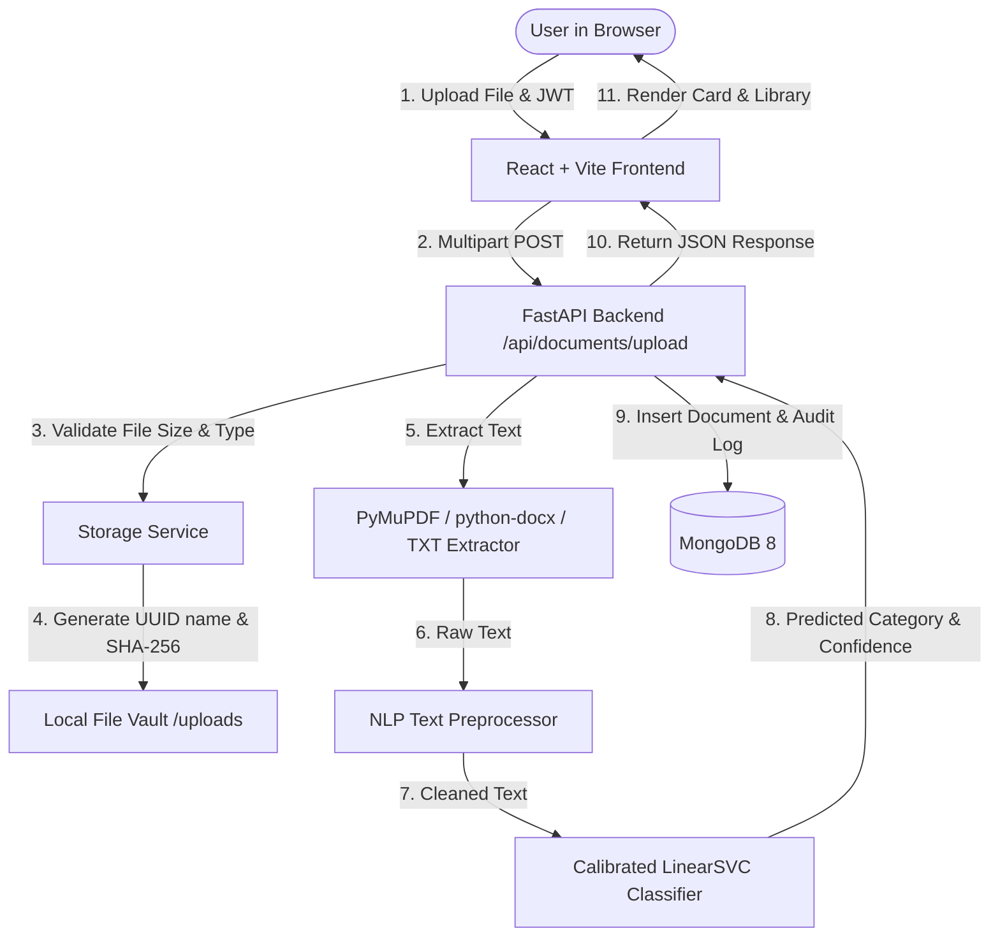

# Smart Document Classification and Management System — Project Explanation

## 1. Executive Summary & Purpose
This project is an end-to-end, production-grade web application developed as a B.Tech IV Year DevOps & Full Stack course project. It automates digital document organization by extracting raw textual content from uploaded files (PDF, DOCX, TXT) and classifying them into enterprise categories using an empirical Natural Language Processing (NLP) machine learning pipeline.

---

## 2. Technology Selection & Architectural Justifications

### Frontend: React.js (Vite) + Tailwind CSS + Recharts
- **React.js & Vite**: Fast HMR (Hot Module Replacement), minimal bundle overhead, component-based modular UI.
- **Tailwind CSS**: Utility-first styling for a clean SaaS aesthetic inspired by Linear and Notion.
- **Recharts**: Declarative charting library for reactive data visualization (category distribution pie charts, 14-day activity trends, evaluation bar charts).
- **Lucide React**: Clean, modern icons without unnecessary design bloat.

### Backend: Python 3.12 + FastAPI + Pydantic v2
- **FastAPI**: Asynchronous REST framework offering native OpenAPI/Swagger documentation, high concurrency, and Pydantic validation.
- **Motor / PyMongo**: Native asynchronous MongoDB driver preventing thread blocking during database reads/writes.
- **Python-jose & bcrypt**: Industry-standard cryptographic password hashing and stateless JWT bearer token authentication.

### NLP & Machine Learning: Scikit-learn Pipeline
- **Linear Support Vector Machine (LinearSVC)**: Text classification in high-dimensional feature spaces is typically linearly separable. Linear SVM is computationally efficient, deterministic, and outperforms complex deep learning models on small-to-medium text corpora.
- **CalibratedClassifierCV**: Linear SVM natively produces raw geometric decision scores ($w^T x + b$), which are uncalibrated distances rather than probabilities. We wrap `LinearSVC` with `CalibratedClassifierCV(cv=3, method='sigmoid')` (Platt scaling) to output mathematically calibrated probabilities (`predict_proba`).
- **TF-IDF Vectorization**: Sublinear TF scaling with unigrams and bigrams (`ngram_range=(1, 2)`) preserves structural phrases such as "master services agreement" or "terms of service".

### Document Processing: PyMuPDF + python-docx
- **PyMuPDF (`fitz`)**: Fast, high-fidelity vector text extraction from PDF pages without relying on slow external OCR unless necessary.
- **python-docx**: Traverses XML body paragraphs and table cell runs to extract formatted business document text.

---

## 3. End-to-End System Workflow



1. **Authentication**: The user registers or signs in at `/login`. Passwords are encrypted with `bcrypt.gensalt()`. A signed JWT is returned and stored in browser memory/localStorage.
2. **Ingestion**: The user uploads a file through the drag-and-drop interface. The backend validates format and file size (&le; 15 MB).
3. **Storage Security**: Files are saved with non-deterministic UUID filenames (`<uuid>.<ext>`) outside public static directories. Path traversal protection verifies that the canonical path stays strictly inside `UPLOADS_DIR`.
4. **Extraction**:
   - PDF files are parsed via PyMuPDF vector extraction. Scanned PDFs with zero extractable text are identified and flagged.
   - DOCX files are parsed for both body text and tabular cell data.
   - TXT files are decoded with multi-encoding fallback (`utf-8`, `utf-8-sig`, `latin-1`, `cp1252`).
5. **Preprocessing**: The raw string undergoes Unicode NFKD normalization, lowercasing, email/URL substitution, special character removal, and whitespace normalization.
6. **Classification & Scoring**:
   - The TF-IDF vectorizer converts the string into an n-gram feature vector.
   - Calibrated LinearSVC computes the probability distribution across all 7 classes.
   - The top class and its calibrated probability score are determined.
   - **Conservative Threshold Strategy**: If the maximum probability is &lt; 0.40, or if the top two categories have a probability margin &lt; 0.08, the document is flagged with `needs_review=True`.
7. **Persistence**: Document metadata, word counts, text previews, category predictions, and audit trail entries are stored in MongoDB collections.
8. **User Correction**: If a user updates the category via the UI, the correction is stored in `manually_corrected_category` without overwriting the original prediction, maintaining transparency.

---

## 4. Database Schema Design (MongoDB)

### Collection: `users`
- `_id`: ObjectId (Primary Key)
- `name`: String
- `email`: String (Unique index)
- `password_hash`: String (Bcrypt hash)
- `created_at`: DateTime (UTC)

### Collection: `documents`
- `_id`: ObjectId (Primary Key)
- `user_id`: String (Indexed for tenancy isolation)
- `original_filename`: String
- `stored_filename`: String (UUID-based name)
- `file_hash`: String (SHA-256)
- `file_type`: String (`pdf`, `docx`, `txt`)
- `file_size`: Integer (bytes)
- `word_count`: Integer
- `extracted_text`: String
- `text_preview`: String (first 500 characters)
- `extraction_status`: String (`success`, `empty`, `failed`, `unsupported`)
- `predicted_category`: String (Indexed)
- `manually_corrected_category`: String or Null (Indexed)
- `classification_score`: Float (Calibrated probability, 0.0 to 1.0)
- `needs_review`: Boolean (Review flag)
- `alternatives`: Array of `[category, score]` tuples
- `model_version`: String
- `processing_status`: String (`complete`, `pending`)
- `uploaded_at`: DateTime (Indexed, UTC)
- `updated_at`: DateTime (UTC)

### Collection: `activity_logs`
- `_id`: ObjectId
- `user_id`: String (Indexed)
- `document_id`: String
- `action`: String (`upload`, `delete`, `category_correction`, `reclassify`)
- `details`: Object (Action metadata)
- `timestamp`: DateTime (Indexed, UTC)

---

## 5. Debugging & Maintenance Guide

### How to debug database connectivity
If the backend logs `❌ MongoDB connection failed`:
1. Check if MongoDB service is running: `Get-Service MongoDB` (Windows) or `systemctl status mongod` (Linux).
2. Test connection string via CLI: `mongosh mongodb://localhost:27017`.
3. Check `.env` configuration for `MONGODB_URL`.

### How to retrain the model with custom documents
1. Add new labeled text rows to `backend/ml_training/dataset/labeled_dataset.csv`.
2. Format: `"document text content here","category_name"`.
3. Run training script:
   ```bash
   cd backend
   python -m ml_training.train
   ```
4. Restart or call the backend reload hook; the updated model and `model_metrics.json` are loaded automatically.

